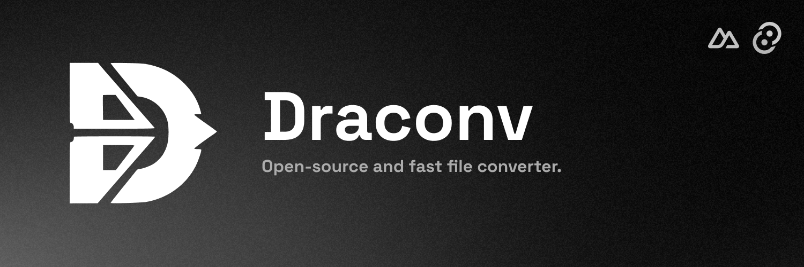
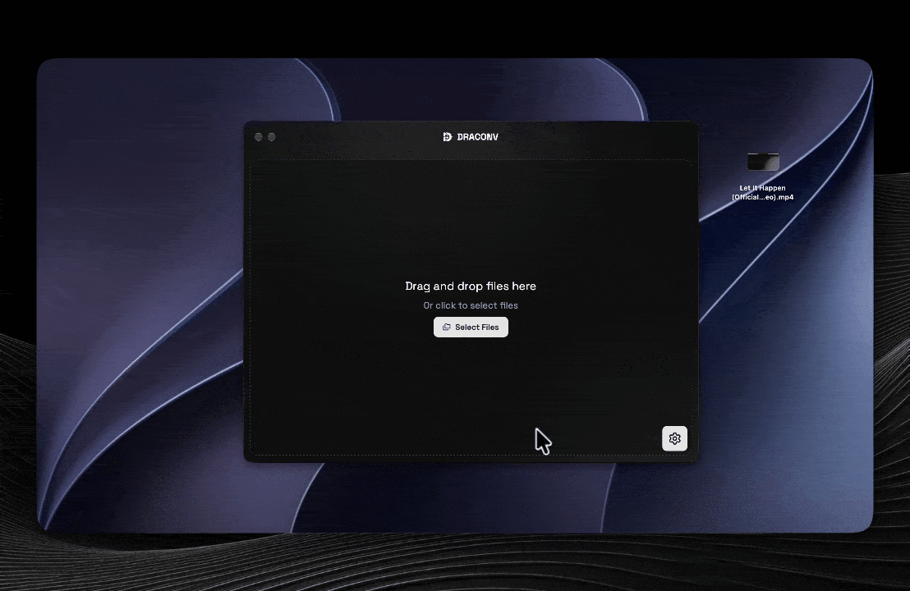
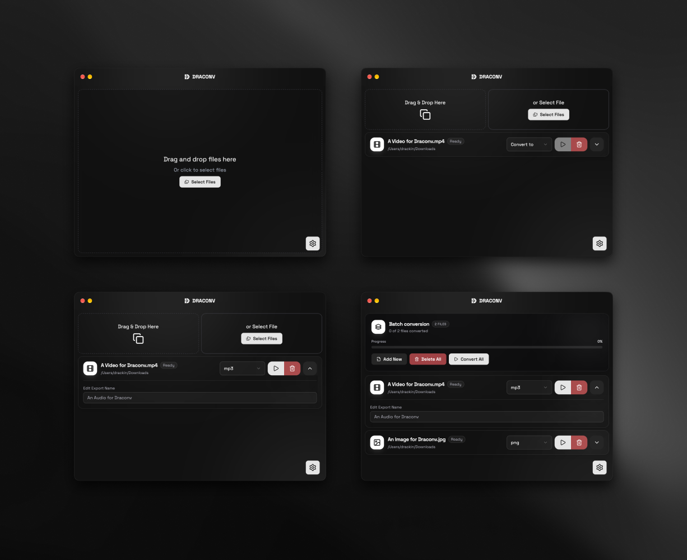

[](https://github.com/Drackin/Draconv/issues)

[](https://github.com/Drackin/Draconv/releases)

⭐️ Star this project on GitHub to support it and keep me motivated. Also to stay updated with the latest releases.

<!-- omit in toc -->
## Table of Contents
- [About](#about)
- [Key Features](#key-features)
- [Screenshots](#screenshots)
- [Download](#download)
  - [Releases page](#releases-page)
- [Incoming Features](#incoming-features)
- [Tech Stack](#tech-stack)
- [Known Issues](#known-issues)
- [License](#license)

## About
Draconv is a lightweight, cross-platform video conversion application built with Tauri and Nuxt. It leverages the power of FFmpeg to provide fast and efficient video processing while maintaining a minimal and user-friendly interface. Draconv is designed to be simple yet powerful, allowing users to convert videos with ease while preserving the original quality. The application is open-source and aims to provide a seamless experience for video conversion across different operating systems.

## Key Features

- 💻 **Cross-platform**: Works on Windows, macOS, and Linux.
- 💨 **Fast Conversion**: Utilizes the power of [FFmpeg](https://ffmpeg.org/) for efficient video processing.
- 🪶 **Minimal UI**: Clean and user-friendly interface. No unnecessary clutter.
- ⬇️ **Drag and Drop**: Easily add files by dragging and dropping them into the app.
- ⚙️ **Customizable Settings**: Adjust conversion settings to fit your needs.
- 🌆 **Lossless Conversion**: Preserve the original quality of your videos.
- ⚡ **Hardware Acceleration**: Leverage your GPU for faster conversions (if supported).
- 🍀 **Open Source**: Fully open-source.
<!-- - **Batch Processing**: Convert multiple files at once. -->

## Screenshots



## Download

| **Platform** | **Download Link** |
|--------------|-------------------|
| Windows      | [.exe, .msi](https://github.com/Drackin/Draconv/releases/latest) |
| MacOS        | [.dmg, .app](https://github.com/Drackin/Draconv/releases/latest) |
| Linux        | [.deb, .rpm, .AppImage](https://github.com/Drackin/Draconv/releases/latest) |

> [!WARNING]
> ### Windows SmartScreen Warning
> You may see "Windows protected your PC" warning because the app is not code-signed yet and also the app has a few downloads. Windows SmartScreen may warn you about running the app. Click on ***"More info"*** and then ***"Run anyway"*** then the app will run normally.

> [!WARNING]
> ### MacOS Gatekeeper Warning
> Same as Windows, MacOS may warn you about running the app because it is not code-signed yet (requires an Apple Developer account).
> If you see ***"Draconv is Damaged"***, open a terminal and run the following command:
> ```bash
> xattr -cr /Applications/Draconv.app
> # or try quarantine removal if the above doesn't work
> xattr -rd com.apple.quarantine /Applications/Draconv.app
> ```

Get the latest release from the:
### [Releases page](https://github.com/Drackin/Draconv/releases/tag/alpha)

## Incoming Features
- [x] Multiple files at once
- [ ] AI Video Upscaling. (Just Thinking)
- [ ] Logging: View detailed logs of conversion processes in a file
- [ ] Better file handling (temporary file until done, select save location, etc)
- [ ] More output formats
- [ ] More conversion options
- [ ] More input/output settings
- [ ] Multiple language support
- [ ] CLI support
- [ ] Useful shortcuts
- [ ] Notifications
- [ ] Conversion History
- [ ] Presets for conversion settings
- [ ] Theme support
- [ ] Preview files before conversion
- [ ] Reorder files in the queue
- [ ] Media download support (YouTube, Instagram, TikTok, etc)

## Tech Stack
This app is built using the following technologies:
- [Tauri v2](https://tauri.app)
- [Nuxt 4](https://nuxt.com)
- [Vue 3](https://vuejs.org)
- [FFmpeg](https://ffmpeg.org/)
- [Tailwind CSS](https://tailwindcss.com/)
- [Pinia](https://pinia.vuejs.org/)
- [Lucide Icons](https://lucide.dev/)
- [@cloudworxx/tauri-plugin-mac-rounded-corners](https://github.com/cloudworxx/tauri-plugin-mac-rounded-corners) (Also thanks to [@cloudworxx](https://github.com/cloudworxx) for making this plugin and helping me with it!)

## Known Issues
- [Linux Error with AppImage] Could not create default EGL display: EGL_BAD_PARAMETER. Aborting... (Tauri issue?)

***Made with Tauri*** ❤️

## License
This project is licensed under the GNU General Public License v3.0 — see [LICENSE](./LICENSE) for details.